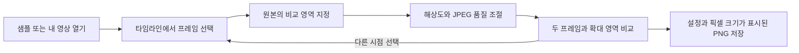

# 서비스 기획서 (Service Planning Document)

| 항목 | 내용 |
| --- | --- |
| 프로젝트명 | FrameCheck |
| 문서 ID | SPD-FRAMECHECK-v0.1 |
| 작성일 | 2026-11-24 |
| 문서 상태 | 초안 · Phase 0 · G0 승인 대기 |
| 작성 / 승인 | 기획 담당 / 프로젝트 책임자 지정 후 승인 |

## 변경 이력

| 버전 | 날짜 | 변경 내용 |
| --- | --- | --- |
| v0.1 | 2026-11-24 | FrameCheck의 사용자 문제, MVP, 검증 기준, G0 결정 항목 정의 |

## 1. 서비스 개요

FrameCheck는 영상 편집자가 업로드나 공유 전에 **같은 장면에서 프레임 해상도와 JPEG 품질에 따른 디테일 차이**를 확인하는 단일 페이지 웹앱이다. 사용자는 샘플을 열거나 기기에서 짧은 영상을 선택하고, 얼굴 등 관심 영역을 확대해 원본과 변환본을 비교한다. 결과는 설정과 실제 픽셀 크기가 기록된 PNG로 저장한다.

### 사용자 문제와 근거

| ID | 사용자·상황·문제 | 현재 대안과 검증 방법 |
| --- | --- | --- |
| OBJ-001 | 영상 편집자가 작은 얼굴이나 눈·입 주변의 디테일을 검수할 때 축소와 압축이 각각 어떤 변화를 일으키는지 비교하기 어렵다는 가설 | 여러 파일을 내보내거나 스크린샷을 수작업으로 정렬할 수 있다. 사전 인터뷰에서 최근 검수 경험을 묻고, 기존 방식으로 동일 장면을 비교하는 과정을 관찰한다. |
| OBJ-002 | 학회 실습 참여자가 비교 결과를 발표용 이미지로 옮길 때 타임스탬프, 설정, 영역 크기를 따로 기록해야 한다는 가설 | 이미지 편집기나 발표 자료에서 두 장면과 수치를 합칠 수 있다. 사용자가 만든 기존 결과물과 누락되기 쉬운 항목을 확인한다. |

문제의 근거는 대화에서 합의한 실습 시나리오다. 사용자 조사 결과는 아직 수집하지 않았다.

| 핵심 사용자 | 이용 상황 | 성공 경험 |
| --- | --- | --- |
| 영상 편집자 · P1 | 짧은 영상에서 얼굴처럼 작게 나온 부분의 디테일을 확인한다. | 같은 프레임과 영역으로 해상도와 JPEG 품질의 영향을 구분한다. |
| 학회 실습 참여자 · P1 | 샘플 또는 사용 권리를 확보한 영상으로 비교 과정을 발표한다. | 도움 없이 실습을 완료하고 사용한 설정과 장면이 표시된 PNG를 만든다. |

## 2. 핵심 메커니즘

영상의 한 시점을 선택하면 브라우저가 해당 프레임을 읽는다. 사용자가 원본에서 지정한 영역을 변환본에도 동일한 위치에 표시한다. 해상도는 원본 대비 비율로 조절하고 JPEG 품질은 독립적으로 조절한다. 변환본에는 선택한 프레임을 실제로 축소하고 JPEG로 인코딩한 결과를 표시한다.

영상 시점은 양쪽에 공통으로 적용한다. 시점이 바뀌면 새 프레임에서 비교 영역을 다시 지정한다. 저장 결과는 브라우저가 실제로 표시한 최신 비교 상태를 기준으로 한다.

## 3. 콘텐츠 및 기능 전략

- 첫 화면에는 `내 영상 열기`와 `샘플로 시작`을 제시하고, 지원 형식·제한과 브라우저 내부 처리 안내를 가까이 둔다. 샘플은 출처와 사용 권리를 확인한 짧은 클립을 준비한다. 발표에는 얼굴이 작게 잡히면서 눈과 입 주변을 확대해 볼 수 있는 장면을 쓴다.
- PC에서는 동일한 구조의 원본·변환 카드를 나란히, 모바일에서는 원본과 변환 순서로 배치한다. 타임라인과 설정은 키보드로 조작할 수 있고, 영역은 드래그 또는 좌표·크기 입력으로 지정할 수 있다.
- 발표 시연은 한 장면에서 해상도와 JPEG 품질을 각각 바꿔보고, 실제 영역 크기의 변화와 보이는 디테일 차이를 설명하는 흐름으로 구성한다. 화면 구조, 문구, 디자인 토큰은 [DESIGN.md](../../DESIGN.md)를 따른다.

## 4. 수익화 전략

학회 실습에서 무료로 제공하는 것을 초안 운영 기준으로 삼는다. 우선순위는 사용자가 비교를 마치고 발표나 검수에 쓸 결과를 얻는지 확인하는 것이다. 결제·구독·광고·계정 운영은 이번 범위에서 제외한다.

## 5. MVP 스코프 정의

| ID | 우선순위 | 포함 범위 | 수용 기준 | 정책 ID |
| --- | --- | --- | --- | --- |
| MVP-001 | P1 | 샘플 및 로컬 영상 열기 | 샘플과 지원 로컬 영상 각각에서 작업을 시작한다. 지원되지 않는 형식이나 용량·길이 제한 초과에는 원인과 다시 시작할 방법을 표시한다. | BP-INPUT-001, BP-INPUT-002, BP-INPUT-003, BP-LOCAL-001, BP-SAMPLE-001 |
| MVP-002 | P1 | 시점 선택과 두 프레임 동기화 | 타임라인 이동 후 두 카드가 같은 시점을 표시하고, 이전 선택 영역이 초기화된다. | BP-COMPARE-001, BP-STATE-001 |
| MVP-003 | P1 | 영역 선택과 확대 | 드래그 또는 좌표·크기 입력으로 지정한 같은 영상 영역이 두 카드에서 같은 표시 크기로 보인다. 실제 픽셀 크기는 각 카드에 표시된다. | BP-COMPARE-002 |
| MVP-004 | P1 | 해상도·JPEG 품질 조절 | 검증 장면에서 해상도만 낮추면 변환 영역의 픽셀 크기가 줄고, JPEG 품질만 바꾸면 픽셀 크기가 유지된다. 원본 표시에는 같은 프레임이 유지된다. | BP-COMPARE-003, BP-STATE-001 |
| MVP-005 | P1 | 비교 PNG 저장 | 두 프레임과 유효한 영역의 최신 비교 결과를 PNG로 저장한다. 시점, 해상도, JPEG 품질 및 각 영역의 실제 크기가 화면 값과 일치한다. | BP-EXPORT-001, BP-EXPORT-002, BP-STATE-002 |
| MVP-006 | P1 | 데스크톱·모바일 사용 | 두 화면 유형에서 영상 열기부터 저장까지 진행한다. 키보드로 타임라인, 영역 수치 입력, 설정과 저장을 조작할 수 있다. | BP-COMPARE-002, BP-STATE-002 |

| ID | 제외 범위 | 재검토 조건 |
| --- | --- | --- |
| EX-001 | 딥페이크 판정, 얼굴 자동 검출과 모델 점수 | 학회 연구에서 탐지 모델과 검증 기준을 확보한 뒤 연계 여부 검토 |
| EX-002 | 전체 영상 재인코딩, 실제 영상 코덱 품질 측정, 일괄 처리 | 프레임 단위 검수 실습 이후 영상 단위 검수 수요 확인 |
| EX-003 | 회원 계정, 클라우드 저장·공유, 결제·광고 | 실습 이후 반복 사용과 외부 협업 수요 확인 |

## 6. KPI 가설 검증 프레임워크

다음 수치는 실습에서 사용할 **제안 기준**이다. 기능의 수용 기준은 5절에서 별도로 판정한다. 영상 편집 경험이 있는 학회 참여자 5명을 모집해 같은 시나리오를 수행하도록 한다.

| ID | 가설 | 측정 방법·출처 | 제안 성공 기준 | 판정 시점 |
| --- | --- | --- | --- | --- |
| KPI-001 | 첫 사용자가 비교 결과를 스스로 저장할 수 있다. | 시작 버튼 선택부터 지정 영역의 PNG를 열어 확인할 때까지 관찰한다. 진행자가 순서를 안내한 시도는 독립 성공에 포함하지 않는다. | 시작 참가자 5명 중 4명 이상이 도움 없이 완료 | 첫 사용 과제 종료 후 |
| KPI-002 | 사용자가 두 변환 조건의 영향을 구분할 수 있다. | 해상도와 JPEG 품질을 각각 바꿔본 뒤, 각 조작이 변환 영역의 픽셀 크기에 미치는 영향을 말로 설명하게 한다. | 두 조작을 시도한 참가자 5명 중 4명 이상이 둘 다 정확히 설명 | 비교 과제 종료 후 |

관찰 기록에는 완료 여부, 막힌 단계, 설명의 정확성을 남긴다. 참여자의 영상 원본과 프레임 이미지는 KPI 자료로 수집하지 않는다. 기준 표본에 미달하면 분자·분모와 관찰된 문제를 보고하고 가설 판정은 보류한다.

## 7. 다음 단계

### G0 검토

- [ ] 사용자 문제의 가설과 현재 확보한 근거를 검토한다.
- [ ] MVP·제외 범위, 파일 제한, 미리보기·저장 정책과 KPI 기준을 확인한다.
- [ ] 미결 결정에 담당자와 기한을 지정하고, 승인자·날짜·대상 버전·근거를 기록한다.
- [ ] 승인한 범위 ID와 개별 정책 ID를 SRS와 유스케이스에 연결하고 RTM에 기록한다.

### 가정·의존성·미결 결정

| ID | 확인할 항목 | 영향 | 담당·기한 | 상태 |
| --- | --- | --- | --- | --- |
| DEC-001 | 배포용 샘플 클립의 후보, 사용 권리, 발표 장면 확정 | MVP-001, 발표 재현성 | 콘텐츠 담당 / G0 검토 | 미결 |
| DEC-002 | 데스크톱·모바일 검증에 사용할 기기·브라우저와 MP4·WebM 샘플 조합 확정 | MVP-001, MVP-006 | 개발·검증 담당 / G0 검토 | 미결 |
| DEC-003 | 실습 참여자 모집, KPI 표본·임계값 승인 | OBJ-001~002, KPI-001~002 | 기획 담당 / G0 검토 | 제안 기준 |
| DEC-004 | 별도 PRD 제공 시 대화 기획안·디자인 가이드와 대조 | 기획 기준선, 변경 시 관련 MVP·정책 | 기획 담당 / PRD 입수 후 | 제공 전에는 대화 기획안을 기준으로 작성 |

## 8. 관련 문서

- FrameCheck 웹앱 구현 계획 · 대화에서 합의한 서비스 흐름, MVP 범위 및 실습 완료 기준. 별도 `PRD.md`는 확인되지 않아 사용자와 합의한 대로 이 계획을 제품 요구사항 출처로 사용했다.
- [DESIGN.md](../../DESIGN.md) · 화면 구성, 조작부, 상태 메시지, 반응형 및 접근성 기준.
- [비즈니스 정책서](비즈니스정책서.md) · 입력, 비교, 저장 및 브라우저 처리의 공통 규칙.
- [워터폴 산출물 가이드](../AGENTS.md) 및 [G0 검토 체크리스트](../08-검토/단계별검토-체크리스트.md#phase-0-기획-검토) · 승인 기준과 기록 위치.
- [요구사항 명세서](../01-요구사항분석/요구사항명세서-SRS.md) 및 [요구사항 추적 매트릭스](../01-요구사항분석/요구사항추적매트릭스-RTM.md) · G0 승인 이후 작성할 후속 산출물.
