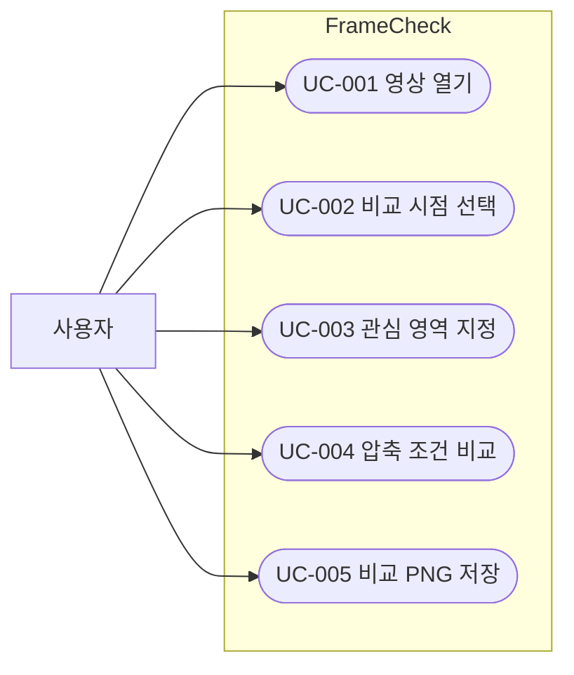

# 유스케이스 명세서

| 항목 | 내용 |
| --- | --- |
| 프로젝트 | FrameCheck |
| 문서 ID | UC-FRAMECHECK-v0.1 |
| 작성일 | 2026-11-24 |
| 상태 | Phase 1 초안 · G0 기준선 확정 및 G1 승인 대기 |
| 기준 | SRS-FRAMECHECK-v0.1, SPD-FRAMECHECK-v0.1, BPD-FRAMECHECK-v0.1, DESIGN.md |

## 변경 이력

| 버전 | 날짜 | 변경 내용 |
| --- | --- | --- |
| v0.1 | 2026-11-24 | 영상 열기부터 프레임 비교와 PNG 저장까지 정상·대안·예외 흐름 정의 |

## 1. 유스케이스 다이어그램

영상 열기 후에는 기본 프레임이 준비된다. 사용자는 다른 시점을 고르거나 현재 시점에서 영역을 지정할 수 있다. 압축 조건은 프레임이 준비된 상태에서 바꿀 수 있고, 저장에는 최신 비교 결과와 유효한 영역이 필요하다.

## 2. 액터 정의

| 액터 | 역할 |
| --- | --- |
| 사용자 · 주요 | 영상 편집자 또는 실습 참여자. 영상·시점·영역·설정을 고르고 비교 결과를 저장한다. |
| 브라우저 · 보조 | 기기 파일 선택, 영상 디코딩, 이미지 변환과 기기 다운로드 기능을 제공한다. |

## 3. 유스케이스 목록

| UC-ID | 이름 | 우선순위 · 상태 | 주요 기능 요구사항 |
| --- | --- | --- | --- |
| UC-001 | 영상 열기 | P1 · 초안 | FR-001, FR-002, FR-007 |
| UC-002 | 비교 시점 선택 | P1 · 초안 | FR-003, FR-007 |
| UC-003 | 관심 영역 지정 | P1 · 초안 | FR-004 |
| UC-004 | 압축 조건 비교 | P1 · 초안 | FR-005, FR-007 |
| UC-005 | 비교 PNG 저장 | P1 · 초안 | FR-006, FR-007 |

## 4. 유스케이스 상세 명세

### UC-001 · 영상 열기

**사전 조건** · FrameCheck 페이지가 열려 있다.

**기본 흐름**

1. 사용자가 `내 영상 열기`를 누르고 로컬 파일을 선택한다.
2. 앱이 파일 형식과 크기를 확인하고, 읽는 중임을 표시한다.
3. 브라우저가 영상의 실제 재생 길이와 유효 프레임을 확인한다. 앱이 길이 제한을 적용한다.
4. 앱이 영상 이름, 타임라인과 원본·변환 카드에 첫 프레임을 표시한다.

**대안·예외 흐름**

- 샘플 경로 · 사용자가 `샘플로 시작`을 누른다. 앱이 배포된 샘플을 열고 같은 작업 화면을 표시한다.
- 선택 취소 · 파일을 고르지 않고 닫으면 파일 열기 전 상태에서 계속한다.
- 입력 오류 · 형식, 크기, 길이 제한 위반은 각각 해당 원인을 표시한다. 손상·미지원 코덱 등으로 읽을 수 없으면 재생 실패를 표시한다. 다른 파일이나 샘플을 다시 열 수 있다.
- 교체·새로고침 · 다른 영상을 열면 새 영상의 작업 상태를 사용한다. 새로고침 후에는 시작 화면에서 다시 열 수 있다.

**사후 조건** · 성공 시 선택 영상의 첫 프레임과 영역 지정 안내가 표시된다.  
**규칙** · BP-INPUT-001, BP-INPUT-002, BP-INPUT-003, BP-LOCAL-001, BP-LOCAL-002, BP-SAMPLE-001, BP-STATE-001, BP-STATE-002  
**UI 참조** · DESIGN.md의 `{component.start-panel}`, `{component.file-picker}`, `{component.timeline}`  
**SRS 참조** · FR-001 / AC-001, FR-002 / AC-002, FR-007 / AC-007

### UC-002 · 비교 시점 선택

**사전 조건** · 샘플 또는 로컬 영상의 프레임이 준비됐다.

**기본 흐름**

1. 사용자가 타임라인에서 다른 시점으로 이동한다.
2. 앱이 이동 상태를 보여주고 이전 선택 영역을 초기화한다.
3. 같은 새 프레임과 시점으로 원본·변환 카드를 갱신한다.
4. 앱이 새 관심 영역을 지정할 수 있게 안내한다.

**대안·예외 흐름**

- 키보드 사용 · 타임라인에 포커스를 놓고 값을 바꿔 같은 결과를 얻는다.
- 연속 이동 · 여러 시점의 처리가 겹치면 마지막 선택과 일치하는 결과만 반영한다. 최신 프레임 또는 유효한 영역이 준비되기 전에는 저장할 수 없다.

**사후 조건** · 두 카드에 같은 새 시점이 표시되고 비교 영역은 미선택 상태다.  
**규칙** · BP-COMPARE-001, BP-STATE-001, BP-EXPORT-001  
**UI 참조** · `{component.timeline}`, `{component.frame-card}`  
**SRS 참조** · FR-003 / AC-003, FR-007 / AC-007

### UC-003 · 관심 영역 지정

**사전 조건** · 현재 프레임이 표시되어 있다.

**기본 흐름**

1. 사용자가 원본 프레임의 관심 부분을 드래그해 사각형을 지정한다.
2. 앱이 원본 영상 범위 안에 양의 면적이 있는 사각형인지 확인한다.
3. 두 카드에 같은 상대 위치를 표시하고 해당 영역을 같은 크기로 확대한다.
4. 각 확대 영역의 실제 픽셀 크기를 각각 표시한다.

**대안·예외 흐름**

- 좌표로 지정 · 원본 픽셀 좌표와 가로·세로 크기를 입력해 같은 사각형을 지정한다.
- 유효하지 않은 입력 · 면적이 0이거나 경계를 벗어난 입력에는 유효한 범위를 안내한다. 유효한 새 영역이 생성되지 않는다.

**사후 조건** · 유효한 영역이 표시된다. 두 미리보기가 최신 상태라면 저장할 수 있다.  
**규칙** · BP-COMPARE-002, BP-EXPORT-001  
**UI 참조** · `{component.region-input}`, `{component.frame-card}`  
**SRS 참조** · FR-004 / AC-004

### UC-004 · 압축 조건 비교

**사전 조건** · 현재 프레임이 표시되어 있다. 관심 영역이 선택돼 있으면 확대 결과도 함께 비교할 수 있다.

**기본 흐름**

1. 사용자가 `해상도` 또는 `JPEG 품질`을 바꾼다.
2. 앱이 갱신 상태를 표시하고, 같은 원본 프레임을 해당 해상도와 품질로 변환한다.
3. 앱이 원본·시점·선택 영역을 유지하면서 변환 미리보기와 관련 수치를 갱신한다.
4. 사용자가 각 설정을 따로 바꾸며 디테일과 픽셀 크기의 차이를 확인한다.

**대안·예외 흐름**

- 영역 미선택 · 변환된 전체 프레임을 보여준다. 확대 비교는 영역을 선택한 뒤 가능하다.
- 연속 변경 · 마지막 설정을 반영한 결과만 비교·저장에 사용한다.
- 변환 실패 · 실패를 안내하고 현재 조건으로 다시 시도할 수 있게 한다.

**사후 조건** · 최신 설정의 변환 결과가 표시된다. 품질만 바꿨다면 픽셀 크기는 유지된다.  
**규칙** · BP-COMPARE-003, BP-STATE-001, BP-STATE-002, BP-EXPORT-001  
**UI 참조** · `{component.compression-controls}`, `{component.frame-card}`  
**SRS 참조** · FR-005 / AC-005, FR-007 / AC-007

### UC-005 · 비교 PNG 저장

**사전 조건** · 유효한 영역을 지정했고 현재 시점·영역·설정의 두 미리보기가 모두 준비됐다.

**기본 흐름**

1. 사용자가 `비교 PNG 저장`을 누른다.
2. 앱이 두 확대 이미지와 원본·변환 라벨, 각 시점과 실제 영역 크기, 해상도 비율과 JPEG 품질을 한 장에 구성한다.
3. 브라우저가 PNG 다운로드를 제공한다.

**대안·예외 흐름**

- 영역 미선택 또는 갱신 중 · 저장은 비활성 상태다. 사용자에게 영역을 지정하거나 최신 결과를 기다리도록 안내한다.
- PNG 생성 실패 · 실패를 안내하고 같은 조건으로 다시 시도할 수 있게 한다.

**사후 조건** · 성공 시 사용자의 기기에서 다운로드한 PNG를 열 수 있다. 화면과 PNG의 시점·설정이 같고 각 패널의 픽셀 수가 대응한다.  
**규칙** · BP-EXPORT-001, BP-EXPORT-002, BP-LOCAL-001, BP-STATE-002  
**UI 참조** · `{component.button-export}`, `{component.compare-export}`  
**SRS 참조** · FR-006 / AC-006, FR-007 / AC-007

## 5. 관련 문서

- [요구사항 명세서](요구사항명세서-SRS.md) 및 [요구사항 추적 매트릭스](요구사항추적매트릭스-RTM.md)
- [비즈니스 정책서](../00-기획/비즈니스정책서.md) 및 [DESIGN.md](../../DESIGN.md)
