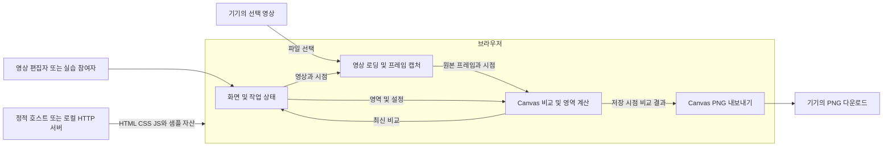

# 시스템 아키텍처 설계서 (SAD)

| 항목 | 내용 |
| --- | --- |
| 프로젝트 | FrameCheck |
| 문서 ID | SAD-FRAMECHECK-v0.1 |
| 작성일 | 2026-11-24 |
| 상태 | Phase 2 설계 초안 · G0·G1 기준선 및 G2 승인 대기 |
| 기준 | SRS-FRAMECHECK-v0.1, UC-FRAMECHECK-v0.1, RTM-FRAMECHECK-v0.1, SPD-FRAMECHECK-v0.1, BPD-FRAMECHECK-v0.1, DESIGN.md |

## 변경 이력

| 버전 | 날짜 | 변경 내용 |
| --- | --- | --- |
| v0.1 | 2026-11-24 | 실행 경계, 비교 데이터 흐름, 픽셀 대응 규칙, 배포 및 검증 설계 작성 |

## 1. 목적과 시스템 경계

FrameCheck는 짧은 영상에서 동일 프레임·영역의 원본과 JPEG 변환본을 비교하는 단일 페이지 정적 웹앱이다. 정적 호스트는 앱과 승인된 샘플 자산을 제공한다. 사용자 파일 검증, 재생, 프레임 추출, 축소·JPEG 인코딩, PNG 생성은 사용자의 브라우저에서 수행한다. 서비스가 생성하는 영구 앱 기록은 없으며, 사용자가 저장한 PNG의 관리 주체는 사용자다.

## 2. 기술 선정 및 구성요소

| ID | 구성요소 | 책임 · 선정 근거 | 관련 요구사항 |
| --- | --- | --- | --- |
| SYS-01 | HTML·CSS·JavaScript 화면 및 작업 상태 | 단일 페이지를 빌드 없이 제공한다. 입력, 화면 상태, 최신 작업 식별자, 반응형 배치와 접근성 상태를 관리한다. | FR-007, NFR-003, NFR-004 |
| SYS-02 | 브라우저 파일 입력 및 `HTMLVideoElement` | MP4·WebM 입력을 검증하고 브라우저가 디코딩한 프레임을 캡처할 수 있게 한다. 사용자 영상은 로컬 객체 URL로 읽는다. | FR-001, FR-002, FR-003, NFR-001, NFR-002 |
| SYS-03 | Canvas 2D 비교 | 동일한 원본 스냅샷에서 축소와 JPEG 인코딩을 수행한다. 원본·변환 픽셀 영역을 계산하고 비교 데이터를 생성한다. | FR-003, FR-004, FR-005, FR-007 |
| SYS-04 | Canvas 2D 내보내기 | 비교 이미지와 메타데이터를 PNG로 합성하고 브라우저 다운로드를 시작한다. | FR-006, FR-007, NFR-001, NFR-002 |

위 구성요소는 책임 범위다. 초기 구현은 `framecheck/dist/` 안의 `index.html`, `styles.css`, `app.js`와 샘플 자산으로 제공한다. 화면 상태와 비교 처리의 계약은 이 문서 및 [API 설계서](API설계서.md)에 정의한다.

## 3. 처리 흐름과 실패 복구

1. **영상 열기** · 파일 선택 취소 시 현재 상태를 유지한다. 로컬 파일은 MP4·WebM 유형과 50,000,000바이트 이하를 먼저 확인한다. 사전 검증을 통과한 파일 또는 샘플로 열기를 시작하면 이전 작업을 무효화하고 비교 조작을 잠근다. 로컬 영상은 메타데이터의 유효한 길이와 양의 프레임 크기를 확인한 뒤, 30초 이하이고 첫 프레임을 읽을 수 있을 때만 비교 화면을 활성화한다. 사전 검증 오류는 기존 작업을 건드리지 않는다. 디코딩 중 실패하면 시작 화면과 오류 안내로 돌아간다.
2. **프레임 선택** · 현재 영상에서 찾기 작업을 한 번에 하나씩 실행하고, 추가 입력은 가장 최근 시점 한 건으로 합친다. 브라우저의 시점 이동이 완료되고 프레임을 읽을 수 있을 때 한 번 캡처한다. 같은 캡처 데이터와 확인된 영상 시점을 두 카드에 공유한다. 다른 시점을 요청하면 기존 영역과 저장 가능 상태를 즉시 초기화한다. 종점에서 디코딩 가능한 프레임이 없으면 마지막으로 읽을 수 있는 지점을 사용하고 실제 캡처 시점을 표시한다. 프레임 찾기 동작의 기준은 HTML 미디어 표준을 따른다. [WHATWG HTML 미디어 탐색](https://html.spec.whatwg.org/multipage/media.html#seeking)
3. **변환과 비교** · 원본 스냅샷에서 대상 크기의 Canvas에 그린 뒤 JPEG로 직렬화하고 다시 디코딩한다. 우측 미리보기와 변환 크롭은 디코딩된 JPEG를 사용한다. 품질 0–100은 Canvas의 0–1 인수로 대응시킨다. 유효한 JPEG 결과를 얻지 못하면 변환 실패로 표시한다. 범위만 바뀌면 동일 프레임·설정의 이미지를 재사용해 크롭을 갱신한다. [WHATWG Canvas 이미지 직렬화](https://html.spec.whatwg.org/multipage/canvas.html#serialising-bitmaps-to-a-file)
4. **최신성 확인** · 영상 교체는 영상 식별자를, 시점 변경은 프레임 요청 식별자를, 설정 또는 영역 변경은 비교 식별자를 갱신한다. 완료 이벤트와 실패는 해당 작업에 필요한 식별자가 현재 값과 일치할 때만 화면에 반영한다. 갱신 작업의 중간 입력은 최신 값으로 합치며, PNG 버튼은 화면의 미리보기와 선택 영역이 모두 현재 상태일 때 활성화한다.
5. **PNG 저장** · 저장을 누른 순간의 비교 결과를 캡처하고, 원본과 변환의 확대 영역을 고정된 좌우 구획에 종횡비를 유지해 그린다. 패널별 라벨·시점·실제 영역 크기와 변환 설정을 함께 합성한다. 생성 중에는 저장 버튼을 비활성화한다. 생성 도중 시점·영역·설정이 바뀌면 이전 생성 결과를 폐기한다. 변환 및 PNG 생성 실패에는 같은 조건의 재시도를 제공한다.

## 4. 픽셀 대응 규칙

이 절은 SRS의 `REQ-DEC-002`에 대한 **G2 검토안**이다.

- 원본 직사각형은 정수 픽셀 경계 `[x, x+w) × [y, y+h)`로 표현한다. 가로·세로는 1 이상이고 원본의 끝 경계에 닿을 수 있다. 드래그 시작점은 화면에 실제로 표시되는 영상 내부에서만 받는다. 끝점이 영상 밖이면 영상 경계에 맞춘다. 두 점의 순서를 정리한 뒤 시작 경계는 내림, 끝 경계는 올림한다. 폭 또는 높이가 0인 드래그는 선택을 만들지 않는다. 좌표 입력에는 정수와 원본 범위를 적용한다.
- 대상 폭·높이는 각각 `max(1, round(원본 크기 × 해상도 비율))`로 계산한다. 동일한 비율을 두 축에 적용하고, 정수 픽셀로 반올림하면서 생긴 차이는 실제 렌더링 크기로 표시한다.
- 대상 축의 시작 경계는 `floor(원본 시작 × 대상 크기 / 원본 크기)`, 끝 경계는 `ceil(원본 끝 × 대상 크기 / 원본 크기)`로 구한다. 각 경계를 대상 범위 안에 둔다. 1px 미만으로 축소되는 유효 영역도 해당 축에서 최소 1px을 포함한다. 표시용 선택선은 원본 영역의 정규화 좌표로 그린다. 확대 패널에서 대응 영역에 같은 표시 공간을 주고, 픽셀 반올림으로 비율이 다르면 이미지 비율을 유지하면서 여백으로 채운다.

| 검증 입력 | 기대 결과 |
| --- | --- |
| 200 × 120 px 영역, 짝수 경계, 정확히 50% 크기의 대상 | 대상 영역 100 × 60 px |
| 원본 101 × 51, 해상도 50%, 끝에 닿는 영역 x=100, y=50, w=1, h=1 | 대상 51 × 26, 영역 x=50, y=25, w=1, h=1 |
| 같은 해상도에서 JPEG 품질만 변경 | 좌표와 픽셀 크기는 유지하고 변환 이미지와 품질 표시를 갱신 |

## 5. 배포와 비기능 대응

| 항목 | 설계와 확인 방법 |
| --- | --- |
| 개발 환경 | 작업 폴더에서 `python3 -m http.server 8000 --bind 127.0.0.1 --directory framecheck/dist`로 제공한다. |
| 시연 배포 | 동일한 정적 파일을 HTTPS 정적 호스트에서 제공한다. 샘플 클립과 포스터는 앱과 동일한 출처에 둔다. 호스트·브라우저 지원 조합은 배포 전 확인한다. |
| 데이터 경계 · AC-008 | 사용자 미디어, 파일명, 영역, 설정, PNG는 외부 요청이나 앱 영구 저장의 입력으로 연결하지 않는다. 네트워크 및 저장소 확인 방법은 API·데이터베이스 설계서에 기록한다. |
| 수명 · AC-009 | 영상 교체·종료 시 디코더에서 이전 소스를 분리하고 객체 URL과 불필요한 이미지 참조를 해제한다. 미완료 변환의 콜백은 참조와 결과를 정리한다. |
| 처리량 · AC-007 | 영상 전체를 프레임 배열로 보관하는 대신 현재 프레임과 변환 이미지를 사용한다. 시점·설정의 연속 입력은 최신 요청으로 합친다. |
| 호환성·접근성 · AC-010, AC-011 | 화면설계서의 768px 전환, 키보드 경로, 오류·로딩 전달을 구현한다. 재생 가능한 MP4·WebM과 대상 환경의 조합은 DEC-002 승인값으로 검증한다. |

## 6. 아키텍처 결정과 G2 검토

| ID | 검토안 | 근거와 영향 |
| --- | --- | --- |
| ADR-001 | 정적 호스팅 + 브라우저 처리 | 핵심 비교에 데이터 서버나 영구 저장소가 필요 없다. 호스트는 배포 자산만 제공하며 변환 가능 여부는 기기와 브라우저에 의존한다. |
| ADR-002 | HTML 미디어와 Canvas 2D | 같은 캡처를 비교와 저장에 재사용한다. 실제 인코딩 품질은 브라우저 구현의 영향을 받으므로 대상 환경에서 결과를 확인한다. |
| ADR-003 | 원본 픽셀 경계 기반 영역 모델과 최신 작업 식별자 | 리사이즈·홀수 크기에서도 대응 위치를 계산하고 오래된 결과가 화면을 덮는 일을 예방한다. 세부 픽셀 규칙은 4절에 기록한다. |

G2에서는 ADR과 대상 문서 버전, 픽셀 대응 규칙, 화면에서 사용하는 초기 설정, 대상 기기·샘플 조합, API·DB 비적용 근거를 확인한다. 승인 근거는 검토 체크리스트에 기록한다. 요구사항별 설계 후보는 이 문서의 SYS-ID와 화면설계서의 SCR-ID를 사용해 승인 후 RTM에 연결한다.

- [SRS](../01-요구사항분석/요구사항명세서-SRS.md), [유스케이스](../01-요구사항분석/유스케이스명세서.md), [RTM](../01-요구사항분석/요구사항추적매트릭스-RTM.md)
- [API 설계서](API설계서.md), [데이터베이스 설계서](데이터베이스설계서.md), [화면설계서](화면설계서.md)
- [워터폴 가이드](../AGENTS.md), [G2 검토 체크리스트](../08-검토/단계별검토-체크리스트.md#phase-2-시스템-설계-검토)

## 7. SYS-05 · 로컬 얼굴 특징점 분석

현재 원본 및 디코딩된 JPEG에서 MediaPipe Face Landmarker를 이미지 모드·CPU로 실행한다. 앱은 사용자가 요청할 때 버전 고정 모듈·WASM·모델을 로드한다. 원본에서 검출한 전체 또는 일부 검사 영역을 JPEG에도 같은 상대 위치로 적용한다. 좌표를 원본 프레임 픽셀에 맞추고, 화면 상태에는 현재 미리보기 식별자와 맞는 결과만 반영한다.

**ADR-004** · 추론을 브라우저에 두고 모델 자산 다운로드만 허용한다. 서버 업로드·저장소 변경 없이 기능을 추가한다. 첫 로딩의 네트워크 의존성과 CPU 브라우저 호환성을 운영 점검에 포함한다. 분석 오류는 기본 비교·저장의 실패로 전파하지 않는다.
