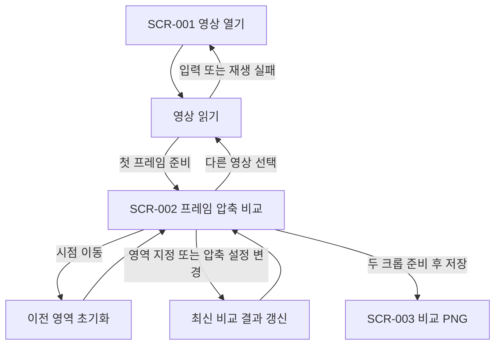

# 화면설계서 (UI/UX)

| 항목 | 내용 |
| --- | --- |
| 프로젝트 | FrameCheck |
| 문서 ID | UIX-FRAMECHECK-v0.1 |
| 작성일 | 2026-11-24 |
| 상태 | Phase 2 설계 초안 · G2 승인 대기 |
| 기준 | DESIGN.md, SRS-FRAMECHECK-v0.1, UC-FRAMECHECK-v0.1, SAD-FRAMECHECK-v0.1 |

## 변경 이력

| 버전 | 날짜 | 변경 내용 |
| --- | --- | --- |
| v0.1 | 2026-11-24 | 시작·비교 화면, 조작부·상태·접근성 및 PNG 결과 명세 작성 |

## 1. 설계 원칙

한 페이지에서 영상 열기와 비교를 이어간다. 원본과 변환본은 같은 시점과 위치를 공통 기준으로 사용하고, 두 카드의 구조와 크기를 맞춘다. 색상·타이포그래피·간격·모서리 규칙은 [DESIGN.md](../../DESIGN.md)의 토큰을 적용한다. 상태와 오류는 조작부 가까이에서 텍스트로 전달한다.

Stitch의 흑백 디자인을 시각 구현 기준으로 사용한다. 옅은 회색 배경, 흰 카드, 검은 기본 버튼, 흰색 영역 표시선과 어두운 외곽선을 적용한다. 시작 및 비교 화면은 동일 페이지의 상태이며, Stitch의 PNG 결과 화면은 저장 이미지 배치의 참고다.

| 화면 | Stitch 참조 | 적용 범위 |
| --- | --- | --- |
| SCR-001 | [영상 열기](../../stitch_design_system_implementation/scr_001/code.html) | 시작 버튼, 입력 안내, 샘플 프레임 |
| SCR-002 | [비교 화면](../../stitch_design_system_implementation/framecheck/code.html), [입력·오류 화면](../../stitch_design_system_implementation/code.html) | 타임라인, 비교 카드, 좌표 조작, 오류와 압축 설정 |
| SCR-003 | [PNG 결과](../../stitch_design_system_implementation/scr_003_png_minimalist/code.html) | 좌우 비교와 메타데이터 배치 |

## 2. 화면 목록과 흐름

| ID | 화면 또는 결과 | 주요 구성 | 출처 |
| --- | --- | --- | --- |
| SCR-001 | 영상 열기 | 파일 선택, 샘플 시작, 입력 제한·처리 안내, 샘플 정지 프레임 | UC-001 / FR-001, FR-002, FR-007 |
| SCR-002 | 프레임 압축 비교 | 영상 교체, 타임라인, 원본·변환 카드, 관심 영역, 압축 설정, PNG 저장 | UC-002~UC-005 / FR-003, FR-004, FR-005, FR-006, FR-007 |
| SCR-003 | 비교 PNG | 원본·변환 확대 이미지와 비교 조건을 담는 다운로드 결과물 | UC-005 / FR-006 |

SCR-001과 SCR-002는 같은 페이지의 상태다. SCR-003은 파일 결과물이다.



## 3. 화면 명세

### SCR-001 · 영상 열기

데스크톱에서는 설명과 버튼을 왼쪽, 샘플 정지 프레임을 오른쪽에 둔다. 모바일에서는 설명과 버튼이 샘플보다 앞선다. 상단에 `FrameCheck`, 제목에 `압축 전후 프레임 비교`, 설명에 `해상도와 JPEG 품질을 바꿔 영상의 디테일을 확인하세요.`를 사용한다.

| 요소 | 표시·동작 |
| --- | --- |
| 내 영상 열기 | 기본 버튼. 기기 파일 선택기를 연다. 대화상자를 취소하면 현재 상태를 유지한다. |
| 샘플로 시작 | 보조 버튼. 배포 샘플을 바로 읽는다. 정지 프레임은 같은 클립의 장면을 사용한다. |
| 사용 안내 | `MP4 · WebM / 최대 30초 · 50MB`, `내 영상은 이 브라우저에서 처리됩니다.`를 시작 버튼 아래에 표시한다. |
| 상태 영역 | 파일명 또는 시작 버튼 근처에 `영상을 여는 중…`과 입력 오류를 표시한다. 첫 프레임이 준비되면 비교 작업을 시작할 수 있다. |

### SCR-002 · 프레임 압축 비교

```text
FrameCheck                       [내 영상 열기] [샘플로 시작]
파일 이름                        현재 시점 / 전체 길이
[──────────────────────── 시점 선택 ────────────────────]
[ 원본 · 전체 픽셀 크기       ] [ 변환 미리보기 · 전체 픽셀 크기 ]
[ 원본 프레임 · 선택 표시     ] [ 변환 프레임 · 선택 표시       ]
[ 원본 확대 · 영역 픽셀 크기  ] [ 변환 확대 · 영역 픽셀 크기    ]
[ 영역 좌표 및 크기 입력 · 적용]
프레임 압축 미리보기
[해상도] [JPEG 품질] [처리 상태]               [비교 PNG 저장]
```

| 조작부 | 표시·동작 |
| --- | --- |
| 타임라인 | 라벨 `시점 선택`과 파일명, `현재 시점 / 전체 길이`를 표시한다. 결과에 쓰는 시점은 캡처 기준으로 두 카드와 저장 파일에 일관되게 표시한다. 다른 프레임이 선택되면 영역을 초기화한다. |
| 비교 카드 | `원본`과 `변환 미리보기`에 각각 전체 프레임 크기를 표시한다. 미디어 주변 여백과 실제 영상 영역을 구분한다. 영역을 지정하면 양쪽 같은 위치에 선택선을 그리고, 확대 이미지와 각 영역의 크기를 `200 × 120 px` 형식으로 표시한다. |
| 영역 드래그 | 원본 프레임에서 포인터 또는 터치로 그린다. 영역이 비어 있으면 `프레임에서 비교할 영역을 드래그하세요.`를 표시한다. |
| 영역 수치 입력 | `가로 위치 (x)`, `세로 위치 (y)`, `너비`, `높이`를 원본 픽셀 단위로 입력하고 `영역 적용`을 누른다. 원점은 영상 왼쪽 위다. 드래그 결과도 입력란에 반영한다. 경계와 픽셀 대응은 SAD 4절을 따른다. |
| 해상도 | 표시 및 선택 단위는 원본 대비 퍼센트다. 초안 선택지는 100%, 75%, 50%, 25%, 기본값은 100%다. |
| JPEG 품질 | 0–100 정수 범위 조절과 현재 값을 제공한다. 초안 기본값은 75다. 두 설정은 독립적이다. 최초 및 새 영상에 기본값을 적용하고, 같은 영상에서 시점을 이동할 때는 유지한다. |
| 비교 PNG 저장 | 유효한 영역과 두 최신 이미지가 준비되면 활성화한다. 갱신 중, 생성 중, 영역 미선택 상태에서는 비활성화하고 근처에 해당 이유를 표시한다. |

해상도 선택지와 기본값, 품질 기본값은 SRS의 `REQ-DEC-001` 검토안이다. 변환본의 픽셀 경계와 최소 크기는 SAD의 `REQ-DEC-002` 검토안을 사용한다.

### SCR-003 · 비교 PNG

한 장의 PNG에 두 확대 이미지를 좌우 같은 크기의 공간에 배치한다. 각 이미지의 비율을 유지하고, 상단에 `원본`과 `변환 미리보기`, 각 패널에 시간과 실제 영역 가로·세로를 넣는다. 변환 조건에는 원본 대비 해상도와 JPEG 품질을 표시한다. 모바일에서도 파일 안의 두 이미지는 좌우로 배치한다. 결과의 시점, 픽셀 수, 설정 문구는 저장한 화면과 같은 값을 사용한다.

## 4. 상태와 오류

| 조건 | 표시 문구 | 동작 |
| --- | --- | --- |
| 지원하지 않는 파일 형식 | `MP4 또는 WebM 파일을 선택하세요.` | 영상 열기 또는 샘플 시작 |
| 용량 초과 | `50MB 이하의 영상을 선택하세요.` | 영상 열기 또는 샘플 시작 |
| 재생 길이 초과 | `30초 이하의 영상을 선택하세요.` | 영상 열기 또는 샘플 시작 |
| 읽기·해독 실패 | `이 브라우저에서 영상을 열 수 없습니다. 다른 영상을 선택하거나 샘플을 사용해 보세요.` | 영상 열기 또는 샘플 시작 |
| 영상 경계를 벗어나거나 면적이 없는 영역 | `원본 프레임 안에서 너비와 높이가 1px 이상인 영역을 선택하세요.` | 입력 수정 또는 다시 드래그 |
| 프레임 이동·미리보기 갱신 | `프레임을 불러오는 중…` 또는 `미리보기를 갱신하는 중…` | 카드 크기 유지, 저장 비활성 |
| 탐색·JPEG 변환 실패 | `프레임을 불러오지 못했습니다.` 또는 `미리보기를 만들지 못했습니다.` | 해당 조작부에서 현재 조건으로 다시 시도 |
| PNG 생성 중·실패 | `PNG를 만드는 중…` 또는 `PNG를 만들지 못했습니다. 다시 시도해 주세요.` | 생성 중에는 잠금, 실패 후 최신 비교가 있으면 다시 저장 |

## 5. 반응형과 접근성

- **768px 미만**에서는 원본 → 변환 순서로 세로 배치한다. **768px 이상**에서는 두 카드를 같은 너비로 나란히 배치한다. 좌우 여백은 각각 16px와 24px이며 콘텐츠 최대 너비는 1120px다. 두 카드에서 같은 상대 위치가 유지되어야 한다.
- 키보드 순서는 영상 열기 버튼 → 타임라인 → 영역 좌표 및 적용 → 해상도·품질 → 저장 순서다. 제어에는 보이는 라벨을 연결하고 포커스를 표시한다. 갱신으로 포커스를 이동시키지 않는다. 주요 조작부는 44px 이상 높이의 터치 영역을 사용한다.
- 상태 영역은 보조 기술이 결과 준비나 오류를 읽을 수 있게 한다. 두 패널은 텍스트로 식별하며, 선택 영역의 좌표와 크기는 프레임 바깥의 텍스트·입력으로도 확인할 수 있다.

## 6. 설계 검증 기준

| 검증 | 출처 |
| --- | --- |
| 샘플과 로컬 영상에서 첫 프레임을 열고 지원하지 않는 입력은 원인에 따라 안내하는지 확인 | AC-001, AC-002 |
| 시점 변경 및 영역 오버레이, 드래그와 좌표 입력의 대응, 해상도·품질의 독립 조작 확인 | AC-003, AC-004, AC-005 |
| PNG 내용이 저장 시점의 두 카드와 일치하는지, 갱신 중이나 오류 때 상태가 맞는지 확인 | AC-006, AC-007 |
| 767px·768px 전환, 데스크톱·모바일 전 과정과 키보드·상태 전달 확인 | NFR-003, NFR-004 / AC-010, AC-011 |

- [DESIGN.md](../../DESIGN.md), [SRS](../01-요구사항분석/요구사항명세서-SRS.md), [유스케이스](../01-요구사항분석/유스케이스명세서.md), [시스템 아키텍처 설계서](시스템아키텍처설계서-SAD.md)

## 7. SCR-002 확장 · AI 얼굴 분석

두 비교 카드 아래에 `AI 얼굴 분석`을 둔다. 최신 변환본이 준비되면 `얼굴 분석` 버튼을 사용할 수 있다. 진행 메시지는 모델 준비와 추론으로 구분한다. 원본을 검출하면 `얼굴 전체`·`눈`·`입` 버튼이 기존 영역 입력값과 두 확대 카드를 갱신한다.

둥근 표식은 눈 특징점, 네모 표식은 입 특징점이다. 원본과 JPEG에서 독립적으로 추정한 점을 각 프레임 위에 그린다. 결과에는 영역별 평균 px와 원본 얼굴 너비 %를 표시한다. 원본·변환본 미검출을 문구로 구분한다. 오류·대기에는 접근 가능한 텍스트 상태를 제공하며 PNG에서는 기존 확대 이미지와 설정을 저장한다.
