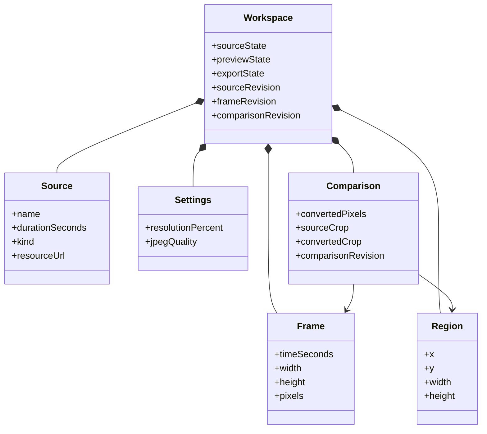
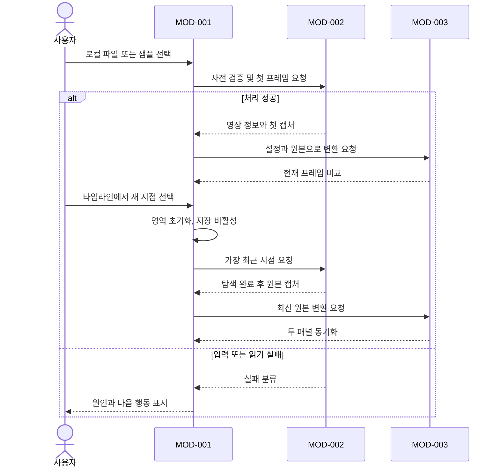
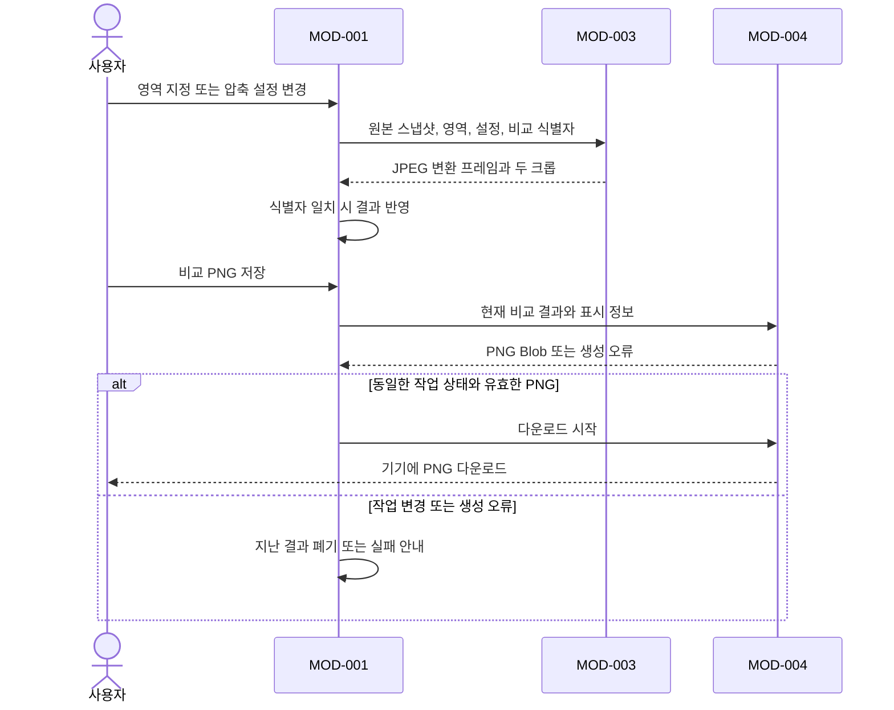
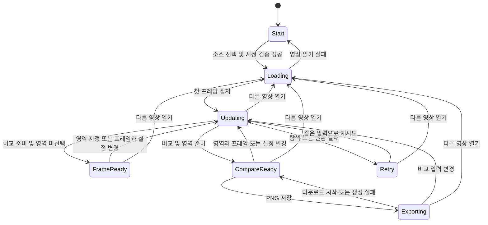

# 상세 설계서 (DDS)

| 항목 | 내용 |
| --- | --- |
| 프로젝트 | FrameCheck |
| 문서 ID | DDS-FRAMECHECK-v0.1 |
| 작성일 | 2026-11-24 |
| 상태 | Phase 3 초안 · 상위 기준선 및 G3 승인 대기 |
| 범위 | 학회 실습용 MVP · 로컬 영상 및 샘플의 프레임 비교와 PNG 다운로드 |

## 변경 이력

| 버전 | 날짜 | 변경 내용 |
| --- | --- | --- |
| v0.1 | 2026-11-24 | 작업 상태, 브라우저 처리 모듈, 좌표 변환, 비동기 처리, 내보내기 상세 설계 |

## 1. 구현 구조

`framecheck/dist/`의 `index.html`은 화면 구조, `styles.css`는 DESIGN.md의 토큰과 반응형 배치, `app.js`는 아래 네 책임 단위를 담당한다. 배포 샘플과 포스터는 같은 출처의 정적 자산이다. 함수명은 구현 기준이며, 브라우저의 기본 객체와 일반 JavaScript 함수 및 객체를 사용한다.

| 모듈 | 책임 | 시스템 설계 연결 |
| --- | --- | --- |
| MOD-001 · 화면 및 작업 상태 | 입력 이벤트 연결, 상태 갱신, 카드·조작부 렌더링, 최신성 및 저장 가능 판정 | SYS-01, SCR-001, SCR-002 |
| MOD-002 · 영상 | 파일 검증, 소스 연결·해제, 탐색 직렬화, 원본 프레임 캡처 | SYS-02, IF-001, IF-002 |
| MOD-003 · 비교 | 영역 입력과 픽셀 대응, 크기 조절, JPEG 변환, 확대 이미지 생성 | SYS-03, IF-003, SCR-002 |
| MOD-004 · 내보내기 | 저장 시점 데이터 합성, PNG 인코딩, 다운로드와 임시 URL 정리 | SYS-04, IF-004, SCR-003 |

### 1.1 객체와 의존 관계

다이어그램의 클래스 표기는 데이터 구조를 나타낸다.

| 데이터 | 저장·참조 규칙 |
| --- | --- |
| Workspace | MOD-001이 페이지 메모리에서 관리한다. 조작 상태와 별개로 실제 캡처 시점과 확정한 영역을 보관한다. |
| Source·Frame | 원본은 캡처당 독립된 픽셀 버퍼다. 탐색 이후에도 이전 작업이 사용하는 버퍼를 다시 그리지 않는다. 프레임 시점은 캡처할 때 한 번 기록해 화면과 PNG에 공통으로 전달한다. |
| Region·Settings | 영역은 원본 픽셀 경계의 정수 직사각형 또는 미선택이다. 설정은 정수 퍼센트와 품질이다. 완료 콜백에는 요청 시점의 값을 전달한다. |
| Comparison | 동일한 원본에서 파생한 변환 프레임과 해당 영역의 크롭·실제 크기를 둔다. 현재 비교가 준비될 때 참조를 교체한다. |
| 저장 스냅샷 | 준비된 비교 이미지와 표시용 시간·픽셀 수·설정 문자열을 저장 클릭 시점에 고정한다. 저장 작업 종료 후 앱의 임시 참조를 정리한다. |

## 2. 주요 시퀀스

### 2.1 UC-001·UC-002 · 영상 열기와 시점 이동

### 2.2 UC-003~UC-005 · 영역·설정 변경과 저장

## 3. 작업 상태와 전이

- **작업 독립성** · 영상 읽기, 비교 갱신, 저장 상태를 별도 필드로 유지한다. 위 다이어그램은 사용자가 보는 상태다. PNG 저장은 활성 소스, 확정 영역, 현재 식별자와 일치하는 비교가 모두 준비되고 저장 작업이 진행 중이지 않을 때 활성화한다.
- **영상 전환** · 파일 선택 취소와 사전 검증 실패는 기존 작업을 유지한다. 사전 검증을 통과한 새 소스 요청은 기존 작업을 무효화한다. 새 영상에서 시점·영역을 초기화하고 압축 기본값을 적용한다. 로딩 중 다른 영상 열기를 선택하면 마지막 소스를 요청한다.
- **최신 결과** · 영상 교체는 소스 식별자를 변경한다. 타임라인 변경은 프레임 식별자를 변경하고 관심 영역을 초기화한다. 각각의 유효한 영역·설정 변경은 비교 식별자를 변경한다. 프레임이 바뀌면 비교 식별자도 갱신한다. 활성 영상·프레임·비교에 해당하는 식별자를 검사한 뒤 결과 또는 오류를 반영한다.
- **요청 합치기** · 같은 영상 요소의 탐색은 한 번에 하나를 수행하고 대기 슬롯에는 마지막 시점만 둔다. 비교 변환도 진행 중 한 건과 대기 중 최신 요청 한 건만 유지한다. 지난 작업의 이미지를 화면에 반영하지 않고 참조를 정리한다. 설정 변경은 프레임 캡처를 취소하지 않으며, 캡처가 완료되면 최신 설정을 읽어 변환한다.

## 4. 모듈 상세

### MOD-001 · 화면 및 작업 상태

| 인터페이스 | 입력 → 출력 | 책임 |
| --- | --- | --- |
| `openSource(source)` | 로컬 파일 또는 샘플 참조 → 영상 상태 갱신 | 사전 검증 결과 처리, 작업 식별자 갱신, 활성 소스 교체 |
| `selectTime(seconds)` | 목표 시점 → 최신 탐색 요청 | 시점 변경 시 영역 초기화, 캡처 시점으로 양쪽 카드 갱신 |
| `applyRegion(region)`, `setCompression(settings)` | 검증 대상 입력 → 비교 상태 갱신 | 유효한 입력 반영, 저장 잠금 및 최신 변환 요청 |
| `renderWorkspace()` | 현재 Workspace → 화면 및 접근성 상태 | 화면설계서의 레이아웃·메시지·활성 조건 반영 |

1. HTML 라벨을 파일 선택, 타임라인, 좌표와 크기, 해상도 및 품질에 연결한다. 포커스 순서는 화면설계서를 적용한다. 상태는 `role="status"` 영역에서, 오류는 가까운 오류 메시지에서 전달하고 조작 중 기존 포커스를 유지한다.
2. `REQ-DEC-001` 검토안은 해상도 `100/75/50/25%`, 기본 `100%`, 품질 `0–100` 정수, 기본 `75`다. 새 영상에서 기본값을 사용하고 동일 영상 내 시점 이동에서는 유지한다.
3. 입력한 영역이 유효하지 않으면 오류를 표시하고 새 영역으로 확정하지 않는다. 기존 영역이 있으면 선택선과 실제 비교 크기는 기존 확정 영역을 기준으로 표시한다. 사용자가 수정 중인 숫자와 확정 영역을 구분한다.
4. 비교 패널은 768px 미만 한 열, 768px 이상 두 열이다. 카드의 실제 미디어 사각형은 렌더링 시점의 크기로 계산하고, CSS 리사이즈 후에도 영역의 원본 픽셀 좌표를 유지한다.

### MOD-002 · 영상 로딩과 프레임 캡처

| 인터페이스 | 입력 → 출력 | 실패·정리 |
| --- | --- | --- |
| `validateLocalFile(file)` | File → 사전 검증 결과 | 미지원 형식 또는 50,000,000바이트 초과 |
| `loadVideo(source)` | 파일 또는 샘플 참조 → 활성 영상 정보와 첫 캡처 | 유효 길이·프레임 부재, 30초 초과 또는 디코딩 실패 |
| `captureFrame(seconds)` | 목표 시점 → Frame | 준비 이벤트 또는 탐색 실패 처리, 교체 시 작업 해제 |
| `releaseSource()` | 현재 영상 → 해제 완료 | 이벤트 구독 해제, 영상 소스 분리와 기존 로컬 URL 해제 |

1. 파일 종류 판정에 MP4·WebM의 브라우저 제공 MIME과 파일 확장자를 사용한다. MIME이 비어 있거나 일반 바이너리 형식이면 확장자를 사용한다. 컨테이너 후보 확인 후 실제 재생 가능 여부는 디코더에서 확인한다.
2. 준비 및 오류 이벤트를 등록한 뒤 영상 소스를 설정한다. 영상 메타데이터에서 양의 유한 길이와 프레임 크기를 확인한다. 30초를 포함하는 상한은 실제 길이에 적용한다. 파일 크기와 시간은 화면 표시용 반올림 이전 값으로 판정한다. 샘플은 같은 출처의 권리 확인된 클립을 쓴다.
3. 초기 캡처에는 프레임 데이터 준비를 기다린다. 시점을 바꿀 때는 일시정지 상태로 `currentTime`을 설정하고 탐색 완료 및 캡처 가능한 영상 데이터를 확인한다. 이미 준비된 현재 시점을 요청하면 기존 프레임을 재사용한다. 영상 끝에서 프레임을 읽을 수 없으면 이전 선택 가능한 지점으로 이동해 가장 가까운 유효 프레임을 사용하면서 캡처한 시점을 표시한다. 그 작업도 실패하면 탐색 오류로 분류한다.
4. 새 소스로 전환할 때 진행 중인 이벤트 대기를 정리하고 기존 영상 소스를 분리한다. URL을 해제하기 전 해당 소스를 사용하는 디코더 참조를 끊는다. 현재 화면의 샘플·로컬 파일 참조만 유지한다.

### MOD-003 · 영역 좌표, JPEG 및 확대 이미지

| 인터페이스 | 입력 → 출력 |
| --- | --- |
| `regionFromDrag(start, end, mediaRect, sourceSize)` | 화면의 드래그 시작·끝과 영상 표시 사각형 → 원본 픽셀 영역 또는 미선택 |
| `validateRegion(region, sourceSize)` | 좌표·폭·높이와 원본 크기 → 유효 영역 또는 범위 오류 |
| `encodePreview(frame, settings)` | 원본과 변환 설정 → 디코딩한 JPEG 프레임과 실제 크기 |
| `buildComparison(frame, converted, region)` | 양쪽 프레임과 유효 영역 또는 미선택 → 비교 결과 |

1. 포인터 입력은 여백을 제외한 영상 사각형을 기준으로 변환한다. 시작점이 영상 밖이면 선택하지 않고, 끝점이 밖이면 경계로 제한한다. 화면상의 움직임이 한 축에서 0인 드래그는 영역을 만들지 않는다. 좌표 순서를 정리한 뒤 원본 시작 경계는 내림, 끝 경계는 올림한다. 수치 입력은 정수와 양의 크기, 원본 범위를 검사한다.
2. `REQ-DEC-002` 검토안을 적용한다. 축별 변환 프레임 크기 `T = max(1, round(S × resolutionPercent / 100))`에 원본 프레임을 그린다. `S`는 해당 원본 축의 크기다. JPEG 품질은 `jpegQuality / 100`으로 전달한다. `image/jpeg` Blob의 생성·형식을 확인하고 디코딩한 이미지를 사용한다. 임시 객체 URL은 이미지 로딩 완료 또는 실패 후 정리한다.
3. 원본의 반열린 구간 `[start, end)`를 대상 축의 `[floor(start × T / S), ceil(end × T / S))`로 대응시키고 대상 범위로 제한한다. 변환 프레임의 마지막 픽셀까지 포함할 수 있다. 오버레이는 원본의 정규화 좌표를 사용하고, 실제 영역 크기 표시는 해당 크롭의 픽셀 차이를 사용한다. 두 확대 패널은 같은 공간에서 각각 비율을 유지해 렌더링한다.
4. 영역만 변경하면 같은 프레임·설정으로 만든 JPEG를 재사용한다. 설정이 바뀌면 항상 같은 원본을 축소·인코딩한다. 갱신 결과는 현재 식별자가 일치할 때만 반영한다.

### MOD-004 · PNG 내보내기

| 인터페이스 | 입력 → 출력 |
| --- | --- |
| `encodeComparisonPng(snapshot)` | 동일 시점의 두 영역 이미지, 공통 표시 문자열 → PNG Blob 또는 생성 실패 |
| `downloadPng(blob)` | 유효한 PNG Blob → 브라우저 다운로드 시작 |

1. 저장 클릭 시 검증한 스냅샷을 고정한다. 임시 Canvas에 좌우 같은 공간을 두고 각 영역을 자르거나 늘리지 않도록 비율을 유지해 그린다. 화면용 표시 문자열을 재사용해 패널별 이름, 시점, 영역 크기와 해상도·품질 값을 그린다.
2. `image/png` Blob의 생성·형식을 확인한다. 생성 도중 영상·프레임·영역·설정이 바뀌면 결과를 폐기한다. 최신 PNG는 객체 URL을 만들어 다운로드하고, 브라우저가 링크 요청을 처리할 수 있는 시점을 지난 뒤 URL과 임시 요소를 정리한다.
3. 생성에 실패하면 화면 설계의 오류 메시지를 표시하며 최신 비교를 유지한다. 브라우저 다운로드를 시작한 상태와 기기에서 파일 저장을 완료한 상태를 구분한다.

## 5. 설계 패턴과 코딩 기준

| 결정 | 적용 |
| --- | --- |
| 단일 작업 상태 | MOD-001이 전이를 관리한다. 버튼 상태와 화면은 현재 작업 데이터를 기반으로 렌더링한다. |
| 최신 요청만 반영 | 동일 작업의 비동기 완료 순서가 뒤바뀌어도 현재 식별자가 일치하는 결과만 반영한다. |
| DOM과 독립된 영역 계산 | 화면 좌표 변환, 유효성 검사, 대응 픽셀 경계를 입력값만으로 계산해 경계 사례를 검증한다. |

HTML·CSS·JavaScript 들여쓰기는 공백 2칸이다. JavaScript는 camelCase, CSS 클래스와 자산 이름은 kebab-case를 사용한다. 사용자 라벨과 오류 안내는 한국어로 작성한다. 실제 브라우저 예외는 사용자가 조치할 수 있는 실패로 분류한다. 사용자 파일·이미지·설정을 네트워크나 영구 앱 저장소에 기록하는 코드가 없는지 리뷰한다.

## 6. 요구사항 연결과 G3 인계

| 모듈 | 요구사항 | 구현 후 확인할 수용 기준 |
| --- | --- | --- |
| MOD-001, MOD-002 | FR-001, FR-002, FR-003 | AC-001~AC-003 · 정확한 제한값과 초과값, 입력 예외, 샘플 권리, 프레임 동기화·영역 초기화 |
| MOD-003 | FR-004, FR-005 | AC-004, AC-005 · 화면 여백과 입력 경계, 대응 위치, 50% 축소와 홀수 가장자리, 품질 독립성, 실제 JPEG |
| MOD-001, MOD-004 | FR-006 | AC-006 · 저장 가능 상태와 화면·PNG의 시점·설정·영역 수치 일치 |
| MOD-001~MOD-004 | FR-007 | AC-007 · 연속 시점·설정 변경과 완료 순서 역전, 실패 분류와 재시도 |
| MOD-002~MOD-004 | NFR-001, NFR-002 | AC-008, AC-009 · 서버 전송·영구 앱 저장 0건, 객체 URL 해제와 새로고침 |
| MOD-001, MOD-002, MOD-003 | NFR-003, NFR-004 | AC-010, AC-011 · 767/768px 전환, 대상 브라우저 조합, 키보드 경로와 상태 전달 |

G3에서는 상위 설계 기준선과 두 압축·픽셀 결정안을 확인하고, 샘플 클립 권리와 검증 환경 결정 상태를 기록한다. 상세설계 승인 이후 모듈 ID를 RTM의 설계 위치에 연결한다. 구현과 테스트 증빙은 각 단계에서 기록한다.

## 7. 참조 문서

- [서비스 기획서](../00-기획/서비스기획서.md), [비즈니스 정책서](../00-기획/비즈니스정책서.md)
- [SRS](../01-요구사항분석/요구사항명세서-SRS.md), [유스케이스](../01-요구사항분석/유스케이스명세서.md), [RTM](../01-요구사항분석/요구사항추적매트릭스-RTM.md)
- [SAD](../02-시스템설계/시스템아키텍처설계서-SAD.md), [API 설계서](../02-시스템설계/API설계서.md), [데이터베이스 설계서](../02-시스템설계/데이터베이스설계서.md), [화면설계서](../02-시스템설계/화면설계서.md)
- [DESIGN.md](../../DESIGN.md), [워터폴 가이드](../AGENTS.md), [단계별 검토 체크리스트](../08-검토/단계별검토-체크리스트.md#phase-3-상세-설계-검토)
